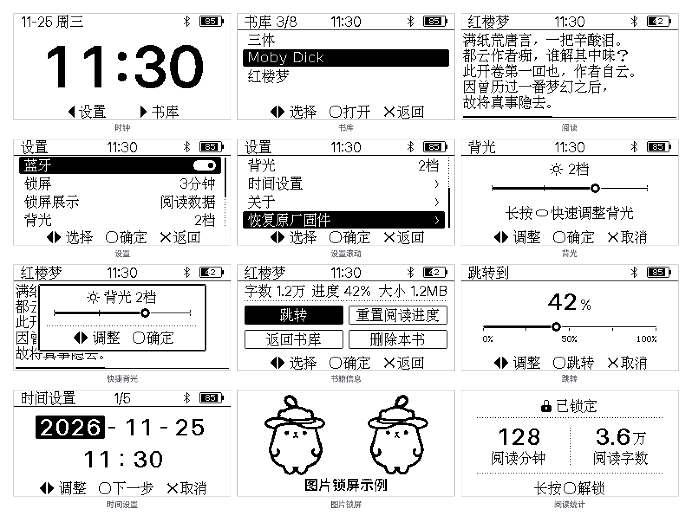

# 喵喵机单词卡 E2/E2S 电子书固件

## 简介

Paperang E2/E2S 的第三方阅读固件。保留原机的系统，可随时切回，提供时钟、书库、阅读、设置和书籍信息页面。

可用配套 APP 蓝牙上传 TXT 书籍和锁屏图片。

## 刷入

下载 Release 中的配套 APP 和固件文件，安装后选择固件按提示无线刷入。首次从原厂固件刷入走原厂升级通道，不需要拆机或走串口。

## 兼容原项目

- 书籍上传：[原版Miaopaper项目](https://github.com/hrp518/Miaopaper) `MiaoPaper.html` 网页工具可直接连接设备，上传 TXT 书籍。
- 锁屏图片：同一网页工具可上传锁屏图片。

## 致谢

- [Miaopaper](https://github.com/hrp518/Miaopaper)：BLE 协议、分页逻辑和网页上传工具。
- [ATC_TLSR_Paper](https://github.com/atc1441/ATC_TLSR_Paper)：早期逆向资料和界面参考。
