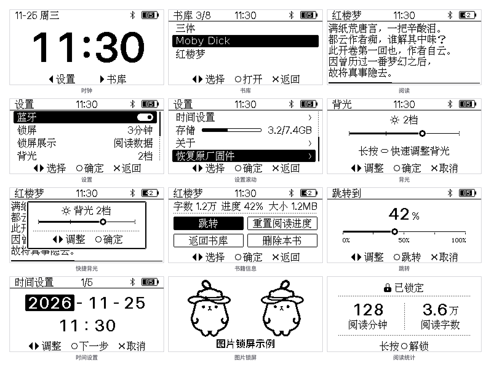

# 喵喵机单词卡 E2/E2S 阅读固件

把 喵喵机单词卡 (Paperang) E2/E2S 变成一台电子书阅读器。

> 说明：源码、字体资产与构建/刷机脚本因许可与体积原因暂未随本仓库分发；文档中的构建步骤见 [`docs/BUILD.md`](docs/BUILD.md)。

## 简介

Paperang E2/E2S 的第三方阅读固件。保留原机的系统，可随时切回，提供时钟、书库、阅读、设置和书籍信息页面。

固件兼容 [Miaopaper](https://github.com/hrp518/Miaopaper) 的网页上传工具。用浏览器通过 BLE 连接设备，可以上传 TXT 书籍和锁屏图片；阅读进度保存在设备上。

## 刷入

下载Release中的刷机助手和固件文件，安装 E2S 刷机助手，在软件中选择固件后按提示无线刷入。助手通过原厂固件的升级通道写入，不需要拆机或串口。

如果设备当前运行第三方固件，先在设置中执行“恢复原厂固件”，再用刷机助手刷入。

刷机助手会校验镜像并在完成后显示结果。构建和手动刷写说明见 [docs/BUILD.md](docs/BUILD.md)。

## 兼容原项目

- 书籍上传：[原版Miaopaper项目](https://github.com/hrp518/Miaopaper) `MiaoPaper.html` 网页工具可直接连接设备，上传 TXT 书籍。
- 锁屏图片：同一网页工具可上传锁屏图片，在设置里把“锁屏展示”切到“锁屏图”后显示。

## 致谢

- [Miaopaper](https://github.com/hrp518/Miaopaper)：BLE 协议、分页逻辑和网页上传工具。
- [ATC_TLSR_Paper](https://github.com/atc1441/ATC_TLSR_Paper)：早期逆向资料和界面参考。
